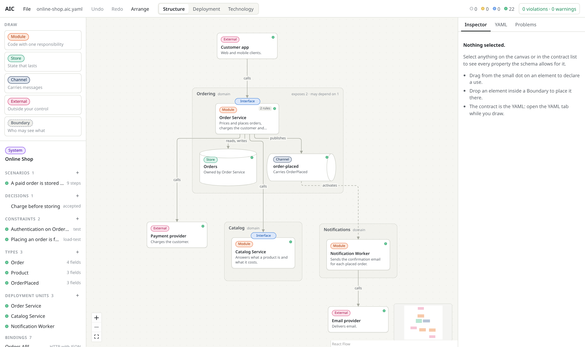
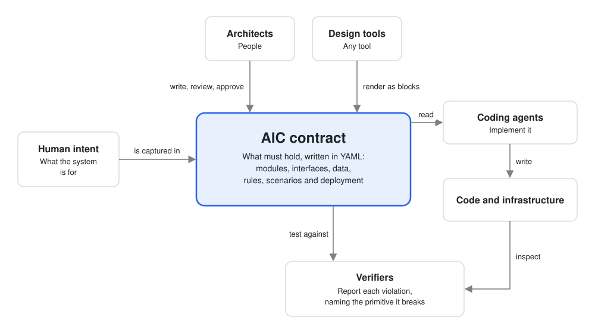
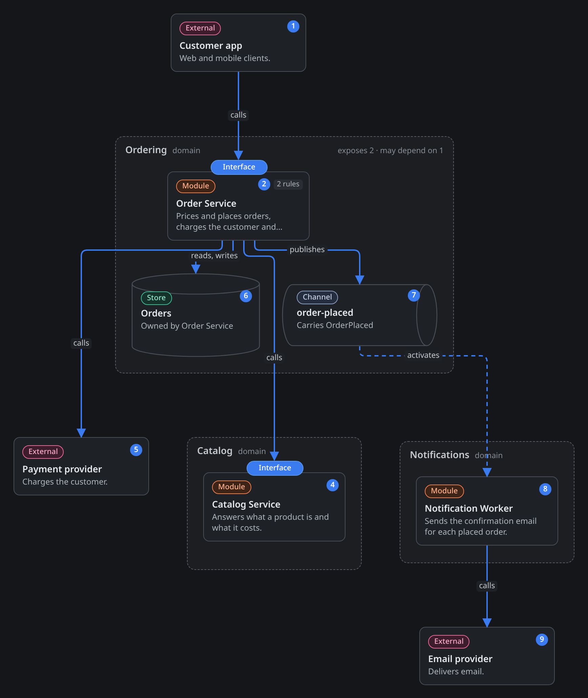
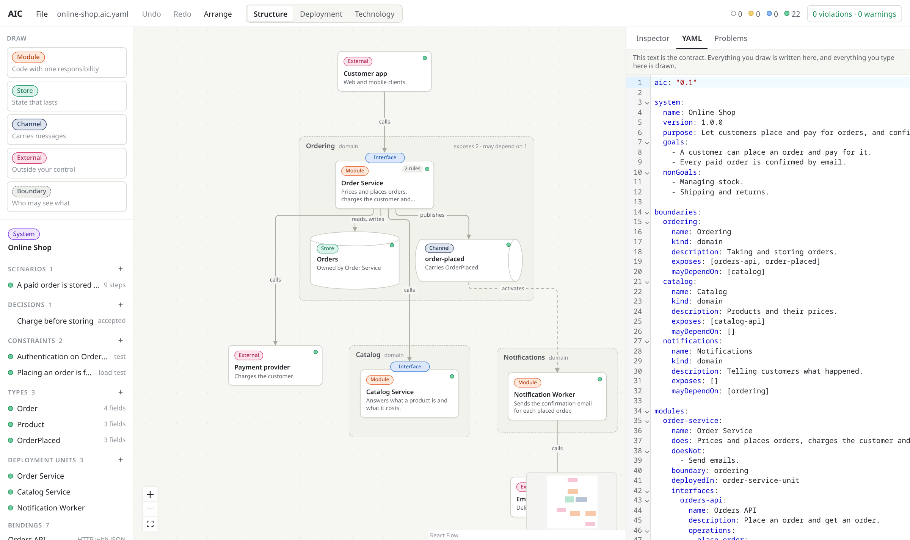
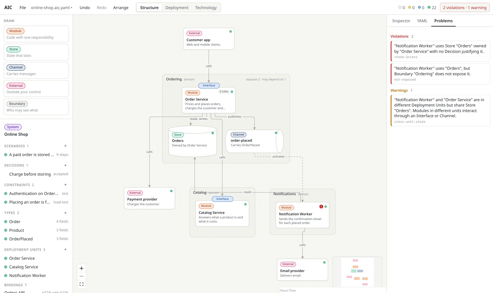
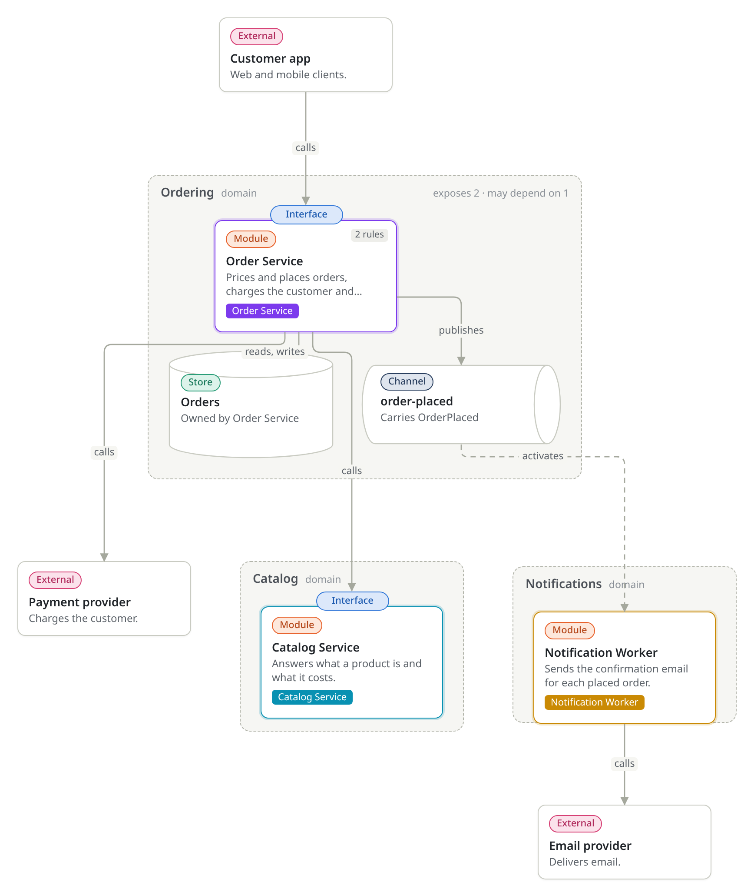
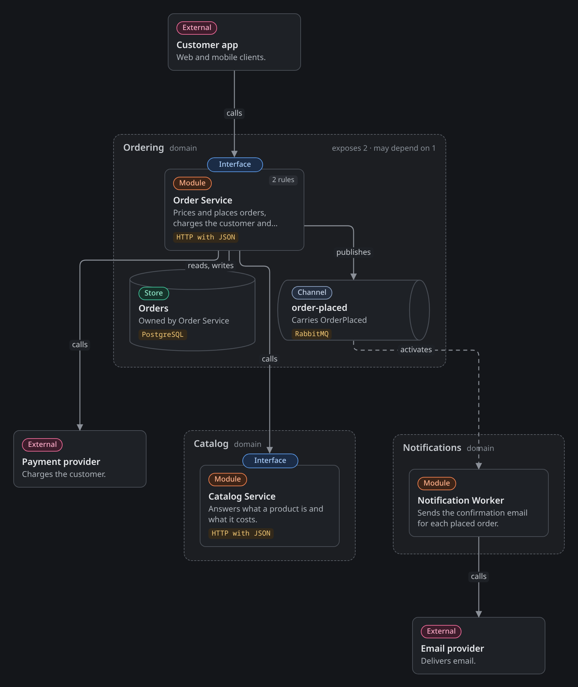
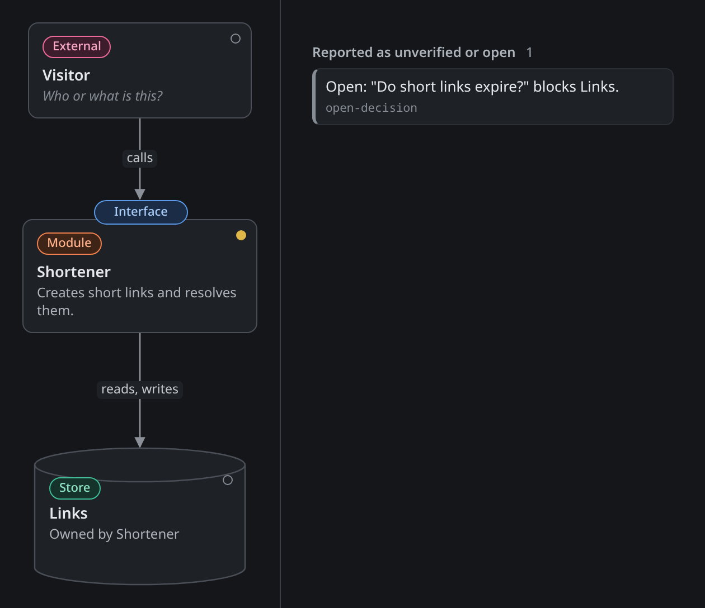

# AIC

**Architecture Implementation Contract**: an open, technology-agnostic contract for software architecture.

Website: [aicspec.dev](https://aicspec.dev)



*An online shop's architecture, rendered from an [AIC contract](examples/online-shop.aic.yaml). The file is the contract; the drawing is one view of it.*

## The problem

Writing code is becoming cheap, but deciding what to build and where its limits lie is not. A coding agent given a vague request makes those decisions itself, silently and differently each time.

Most projects have no durable, enforceable place for their architecture:

| Where architecture lives today | What it leaves out |
| --- | --- |
| Diagrams | They explain a system but bind nothing, and they drift from the code |
| Prose documents and decision records | They capture reasoning, but a machine cannot check them against an implementation |
| OpenAPI and AsyncAPI | They define a boundary precisely, but not why it exists or who may cross it |
| Infrastructure as code | It defines what runs, and says little about the intended structure of the software |
| The code itself | It shows what the system does now, not what it was meant to do or must never do |

So an agent can produce code that passes its tests and still breaks the architecture. Nothing reports the violation, because nothing recorded the rule.

## What AIC is

An AIC contract is a YAML file that records what a system must do, how it is divided, how its parts may interact and how it is deployed. People can read it and machines can check it.

It sits between a human statement of intent and the code:



What separates a contract from a diagram is that **a violation can be detected**. Each statement is a commitment that an implementation can honour or break.

The contract fixes what an architect would want to be consulted about if it changed. Everything else belongs to the implementer:

| The contract fixes | The implementer decides |
| --- | --- |
| Each module's responsibility and limits | Internal design, algorithms and code structure |
| Which parts may interact, and through which interfaces | Libraries and frameworks, unless a Binding fixes them |
| The shape of data crossing a boundary, and who owns each store | Internal data structures |
| Delivery guarantees and required behaviour on failure | The mechanism that achieves them |
| What is deployed together | Pipelines and operational tooling |

## How it helps

- **Architects** get one reviewable source of truth for the decisions that matter, and can start with a sketch and harden it over time.
- **Coding agents** get a bounded task: one module's contract should be enough to implement that module, without reading the whole system or inventing architecture.
- **Verifiers** get something concrete to test an implementation against, and each failure names the primitive it violates.
- **Tool builders** get an open format, so any tool can offer its own interface over the same contract.
- **Teams** can change technology without rewriting the architecture, because technology choices are recorded separately. A change is a difference between versions, so its impact can be computed.

## See it on an example

These screenshots use the [online shop example](examples/online-shop.aic.yaml): customers place orders through an API, payment goes to a third-party provider, and a confirmation email is sent in the background.

They come from an AIC canvas that is still in development and is not published yet. AIC does not depend on it: any tool can render a contract in its own way.

### A scenario traces a path through the structure

A Scenario states an end-to-end behaviour: a starting event and an expected outcome. Selecting one numbers the path it must follow, so you can see whether the structure can deliver it.



### The drawing and the text are the same contract

The contract is plain text, so it can be reviewed and versioned like code. The diagram draws what the YAML on the right says, and an edit on either side updates the other.



This is how the contract describes the worker that sends the email, including what must happen when a message arrives twice or a call fails:

```yaml
notification-worker:
  name: Notification Worker
  does: Sends the confirmation email for each placed order.
  boundary: notifications
  deployedIn: notification-worker-unit
  activatedBy:
    - kind: channel
      channel: order-placed
      onDuplicate: Ignore an event whose order was already confirmed, so one order never gets two emails.
      onFailure: Retry, then set the event aside for review.
  uses:
    - to: email-provider
      modes: [call]
      description: Deliver the confirmation email.
      onFailure: Fail the activation so the event is retried.
```

### Breaking a rule is reported

Here Catalog Service was changed to read the Orders store directly. That store belongs to Order Service, the Ordering boundary does not expose it, and the Catalog boundary may not depend on Ordering, so the change is reported as three violations and a warning.



This check looks at the contract itself. Comparing running code with the contract is the job of a verifier: the [specification defines the checks](spec/aic-specification-0.1.md#conformance-and-evolution), and this repository does not include a verifier.

### Other views of the same contract

Design and deployment answer different questions. Deployment Units say what is built, released and scaled together, and Bindings record the technology. Both can change without touching the structure of the system.

| Deployment Units | Bindings |
| --- | --- |
|  |  |

### Start with a sketch

Nobody has to specify everything up front. This [smallest useful contract](examples/sketch.aic.yaml) is valid, and its gaps are reported as work still to do. An open question stays visible as a Decision until someone answers it, as the list on the right shows.



Elements harden through three maturity levels. The dot on each element above shows where it stands: yellow is Draft, and an empty dot is still below it.

| Level | What it adds | What it enables |
| --- | --- | --- |
| **Draft** | System, structure and prose descriptions | Rendering, discussion and exposing gaps |
| **Specified** | Interfaces, Types, Dependencies with failure behaviour, and Deployment Units | Implementation by an agent without inventing architectural decisions |
| **Verifiable** | Constraints and Scenarios with a defined means of checking | Automated conformance testing |

## The 14 primitives

Familiar concepts map onto these primitives without adding to them. A worker, for example, is a Module activated by a Channel, and a database is a Store.

| Family | Primitives |
| --- | --- |
| Intent | System, Scenario, Decision |
| Structure | Module, Store, Channel, External |
| Interaction | Interface, Dependency, Type |
| Governance | Boundary, Constraint |
| Realisation | Deployment Unit, Binding |

The [specification](spec/aic-specification-0.1.md#the-primitives) explains what each one is and what it obliges.

## What AIC is not

- **A programming language or code generator.** Implementers produce the code by whatever means they choose.
- **A user interface.** Reference tools may exist, but the specification depends on none of them.
- **An interface description language.** Interfaces and Types can point to existing specifications such as OpenAPI, AsyncAPI, Protobuf or JSON Schema.
- **An infrastructure tool.** Deployment Units and Bindings describe what is required, and existing tools realise it.
- **A development process.** The contract does not prescribe who works in what order.

## Use it with a coding agent

A coding agent can use the tools below to validate a contract, plan the work, take one Module at a time and verify the result. There are two ways to give it these tools, and both give the same results.

| | MCP server | Skill and command line |
| --- | --- | --- |
| Set up | `claude mcp add --transport http aic https://aicspec.dev/mcp` | `npx -y @aicspec/cli skill install` |
| Where it runs | On aicspec.dev. The agent sends the contract with each call, and nothing is stored | On your machine. Nothing is sent anywhere |
| Needs | An agent that supports MCP | Node.js 20.10 or later |

Then tell your agent: *Implement aic.yaml with the aic skill. Follow it, build one module at a time, and verify each one.* With the MCP server, say "the aic MCP server" instead.

`skill install` copies [`skills/aic`](skills/aic) into `.claude/skills/aic` for Claude Code. Add `--global` to install it in `~/.claude/skills` for all your projects, or `--dir <path>` to install it in another agent's skills directory.

### The command line

The [`@aicspec/cli`](https://www.npmjs.com/package/@aicspec/cli) package works with or without an agent. Each command reads `aic.yaml`, or the only `*.aic.yaml`, from the current directory. Use `--contract <path>` for another file. A contract split into several files with `$ref` is joined first.

```sh
npx @aicspec/cli validate                 # violations, warnings and maturity; exits 1 on violations, so it fits CI
npx @aicspec/cli plan                     # the Modules in build order, and what blocks each
npx @aicspec/cli brief order-service      # one Module's contract as a bounded task
npx @aicspec/cli checklist order-service  # what an implementation must honour, and how to check it
npx @aicspec/cli verdict results.json     # the conformance verdict from your checklist results
npx @aicspec/cli reference specification  # the documents in this repository
```

Every command except `validate` and `bundle` prints JSON. The verdict rests on the results it is given, and says so: the command line does not inspect code.

The same logic is also available as a library: `import { validateContract, moduleBrief } from '@aicspec/cli'`.

## Status

Version 0.1 is a working draft, so the format may still change.

| Available in this repository | Not available yet |
| --- | --- |
| The specification | A verifier that checks code against a contract |
| The JSON Schema and the contract reference | A published canvas |
| Two example contracts | |
| The `@aicspec/cli` command line and the `aic` skill for coding agents | |

## Read next

| Read this | To learn |
| --- | --- |
| [Specification](spec/aic-specification-0.1.md) | The full model, conformance and a worked example |
| [Contract reference](spec/contract-reference-0.1.md) | Every property of the format |
| [JSON Schema](schema/aic-contract-0.1.schema.json) | The single definition of the format |
| [Online shop example](examples/online-shop.aic.yaml) | A complete contract |
| [Sketch example](examples/sketch.aic.yaml) | The smallest useful contract, a Draft |
| [The aic skill](skills/aic/SKILL.md) | How a coding agent works with a contract |

## Author

Created by Victor Fernandez.

## Licence

Copyright 2026 Victor Fernandez. Licensed under the [Apache License 2.0](LICENSE).
