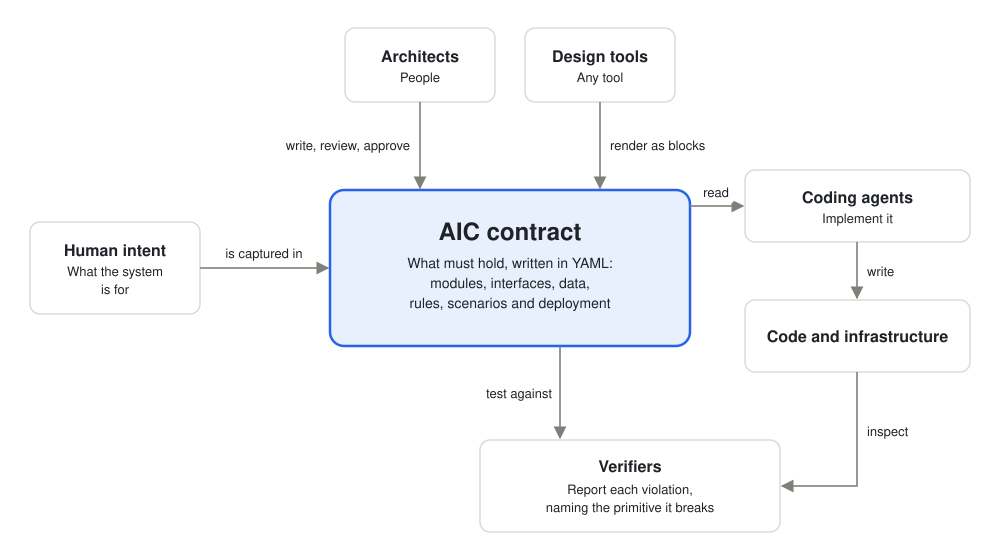
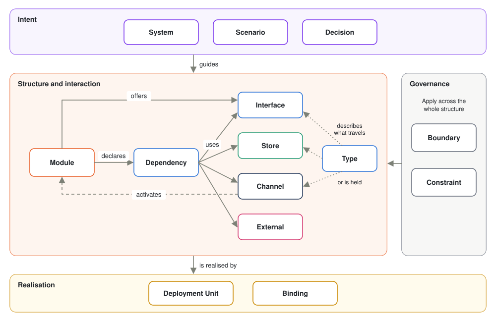
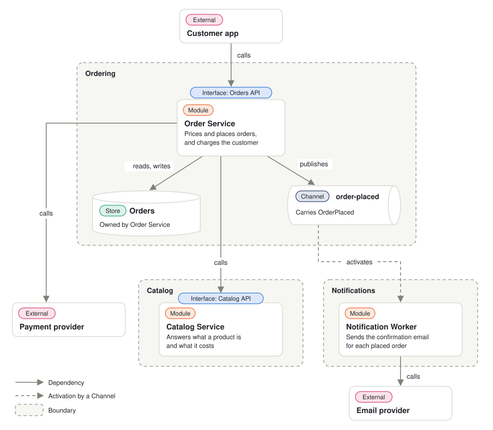

# AIC: An Open Contract for Software Architecture

**Version 0.1, working draft** · Nov 3, 2026 · Victor Fernandez · [aicspec.dev](https://aicspec.dev)

## Abstract

AIC, the Architecture Implementation Contract, is an open, technology-agnostic contract for software architecture. It records what a system must do, how it is divided, how its parts may interact and how it is deployed, in a form people can read and machines can check.

The contract sits below a human statement of intent and above code and infrastructure. Any tool can render it as blocks, any coding agent can implement it, and any verifier can test whether an implementation honours it.

This document, the AIC specification, defines the layer and its 14 primitives. A contract is one system's architecture written with those primitives.

## The problem

Writing code is becoming cheap, but deciding what to build and where its limits lie is not. A coding agent given a vague request makes those decisions itself, silently and differently each time.

Architecture has no durable, enforceable home in most projects today:

- **Diagrams** explain a system but bind nothing. They drift from the code, and no tool notices.
- **Prose documents and decision records** capture reasoning, but a machine cannot check them against an implementation.
- **Interface specifications** such as OpenAPI and AsyncAPI define a boundary precisely, but not why it exists or who may cross it.
- **Infrastructure as code** defines what runs, and says little about the intended structure of the software.
- **The code itself** shows what the system does now, not what it was meant to do or must never do.

An agent working from these sources can produce code that passes its tests and still breaks the architecture. Nothing reports the violation, because nothing recorded the rule.

## The abstraction layer

An AIC contract is a set of architectural commitments that an implementation can honour or break. That property separates a contract from a diagram: a violation can be detected.

*Where the layer sits and who consumes it.*

Agents implement the contract and verifiers test the result against it. Design tools only render it, so they stay replaceable.

### What the contract fixes

The contract states what an architect would want to be consulted about if it changed. Everything else belongs to the implementer.

| The contract fixes | The implementer decides |
| --- | --- |
| Each module's responsibility and limits | Internal design, algorithms and code structure |
| Which parts may interact, and through which interfaces | Libraries and frameworks, unless a Binding fixes them |
| The shape of data crossing a boundary, and who owns each store | Internal data structures |
| Delivery guarantees and required behaviour on failure | The mechanism that achieves them |
| What is deployed together | Pipelines and operational tooling |

Too little detail and the agent invents the architecture. Too much and the contract becomes code written in another notation.

### Who consumes it

- **Architects** write, review and approve it, with or without agent assistance.
- **Design tools** render it as blocks and are where the architect's design experience improves: how the contract is explored, edited and reviewed. Any community tool can offer its own interface over the same contract and compete on that experience.
- **Coding agents** read one module's contract as a bounded task, for example through MCP.
- **Verifiers** compare an implementation with the contract and report each violation.
- **End-to-end tools** built by the community can chain the whole flow, from design to implementation to verification, with every step held to the same contract.

## Design principles

These nine principles decide what enters the specification and what stays out.

1. **The contract is the source of truth.** Interfaces, agents and platforms are replaceable implementations of it.
2. **Violations must be detectable.** A statement is either machine-checkable or explicitly marked as prose, never silently assumed to hold.
3. **Architecture stays separate from technology.** The contract describes parts, how they interact and what data they hold without naming products or frameworks. Technology choices are recorded on their own, so one can change without rewriting the architecture.
4. **The core stays as small as possible.** New patterns are expressed by reusing existing primitives wherever they can. The core grows only when a real need cannot be met that way.
5. **Existing standards are reused.** Where an established format already describes something, such as OpenAPI, AsyncAPI, Protobuf or JSON Schema, the contract refers to it instead of redefining it.
6. **Prose is allowed, but never counts as verified.** Some intent is best stated in words, and agents can read it. Because words are open to interpretation, a prose statement is reported as unverified. An agent or a reviewer may assess it, but that verdict is recorded as a judgement, not as a passing check. A rule that matters should graduate to something machine-checkable.
7. **Presentation is excluded.** How a tool lays out or styles a contract on screen is not part of it. Nor is the contract limited to what a diagram can show: rules, quality targets and decisions belong in it even when no tool draws them.
8. **Rigour is incremental.** A contract can start as a sketch and harden element by element.
9. **Context is minimal.** One module's contract should be enough to implement that module, without reading the whole system.

## The primitives

The model has 14 primitives in five families. A concept becomes a primitive only if it changes what must be implemented or verified; otherwise it is a label on an existing primitive.

API, logic, event and database are all covered, but each by the primitive that matches what it is: an API is an Interface, logic lives in a Module, an event travels on a Channel and a database is a Store. They are not interchangeable blocks of one kind, so a new pattern such as a cache or a webhook maps onto existing primitives instead of requiring a new block type.

*How the primitives relate.*

Every interaction starts at a Module. Types describe what travels, and the bands apply across the whole structure.

| Family | Primitive | What it is | What it obliges |
| --- | --- | --- | --- |
| Intent | **System** | The thing described: its purpose, goals and non-goals | Everything else serves the purpose and respects the non-goals |
| Intent | **Scenario** | An end-to-end behaviour: a starting event and an expected outcome | A path through the structure must produce that outcome |
| Intent | **Decision** | A choice, assumption or open question, with its rationale | Accepted decisions bind; open questions block what depends on them |
| Structure | **Module** | Code with one responsibility, stating what it does and, optionally, what it does not do | It behaves as stated and uses only what it declares |
| Structure | **Store** | State that outlives a request, described by what it holds | It has an owner, a Type and a consistency level |
| Structure | **Channel** | A named conduit that carries messages between Modules, such as a topic, queue or stream | It declares the Type carried and delivery guarantees; its producers and consumers follow from the Dependencies and activations that name it |
| Structure | **External** | Anything the team does not control: users, third parties, upstream systems. It may reference another AIC contract by name and version | What the system assumes about it is stated; if it references a contract, only what that contract exposes may be used |
| Interaction | **Interface** | What a Module offers to others | Callers use only what is declared; it may reference an existing specification |
| Interaction | **Dependency** | A directed use of an Interface, Store, Channel or External, with one or more modes: call, publish, read or write | Undeclared use is a violation; it states its modes and failure behaviour |
| Interaction | **Type** | The shape and meaning of data that crosses a boundary or is stored | Data conforms to it wherever it is declared |
| Governance | **Boundary** | A named grouping of elements, such as a domain, layer or service, with visibility rules: which of its elements are exposed outside it, and which other Boundaries it may depend on | Interactions crossing it follow its rules |
| Governance | **Constraint** | A measurable requirement or rule: a quality target, an architectural rule or a cross-cutting requirement such as authentication, rate limiting or encryption. It applies to the whole system or is attached to specific elements | It holds wherever it applies, and it names how it is checked |
| Realisation | **Deployment Unit** | What is built, released and scaled together | Each Module is placed in exactly one unit |
| Realisation | **Binding** | A mapping from a logical element to a concrete technology, written by the architect as free text | The implementation uses that technology; replacing it leaves the logical contract unchanged |

### Rules that cut across primitives

- **Activation.** A Module runs because of a call to its Interface, a message from a Channel, a schedule or continuous execution. Activation is a property of the Module, so a worker and a scheduled job need no primitives of their own.
- **Ownership.** Each Store has one owner, a Module or a Boundary, as the architect chooses. When a Boundary owns it, any Module inside that Boundary may use it. Access from outside the owner must be declared and justified by a Decision.
- **Design and deployment are independent.** A Boundary and a Deployment Unit answer different questions. A Boundary says who may see and depend on what; a Deployment Unit says what is built, released and scaled together. They often coincide, as in a microservice, but need not: a modular monolith holds several Boundaries in one Deployment Unit, and a domain whose API and worker scale separately is one Boundary across two Deployment Units. Modules in different units must interact through a declared Interface or Channel.

## Common concepts in terms of the primitives

Familiar architectural concepts map onto the primitives without adding to them. A tool can still draw any of these as its own block.

| Familiar concept | Expressed as |
| --- | --- |
| Business logic | A Module |
| HTTP API or RPC service | An Interface on a Module |
| Worker | A Module activated by a Channel |
| Scheduled job | A Module activated by a schedule |
| Event or message | A Type carried by a Channel |
| Database | A Store |
| Cache | A volatile Store related to its source Store |
| Gateway, router or backend for frontend | A Module with a role |
| Authentication or rate limiting | A Constraint attached to Interfaces or Dependencies |
| Frontend | A Module if the team builds it, an External otherwise |
| Third-party service | An External |
| Layer or domain | A Boundary |
| Microservice | A Deployment Unit, usually matched by a Boundary |
| Kafka, PostgreSQL or Kubernetes | A Binding |

A role is a descriptive label on a Module. Tools can use it for rendering or templates, but it creates no obligations of its own.

## Maturity levels

A contract hardens through three levels, so nobody has to specify everything up front. Levels apply to each element, and a validator reports where each one stands.

| Level | What it adds | What it enables |
| --- | --- | --- |
| **Draft** | System, structure and prose descriptions | Rendering, discussion and exposing gaps |
| **Specified** | Interfaces, Types, Dependencies with failure behaviour, and Deployment Units | Implementation by an agent without inventing architectural decisions |
| **Verifiable** | Constraints and Scenarios with a defined means of checking | Automated conformance testing |

An element should reach Specified before an agent is asked to implement it. Open Decisions keep gaps visible at every level.

## Conformance and evolution

An implementation conforms when every applicable check passes and every unverified statement is reported as unverified. Passing must never hide what was not checked.

### Checks

| Check | Question it answers |
| --- | --- |
| Structural | Does each Module use only its declared Dependencies, and is each Store accessed only as declared? |
| Interface and Type | Does the implementation expose and consume what was declared, with conforming data? |
| Scenario | Does the expected outcome occur, through the declared path? |
| Constraint | Does each rule hold by its stated means, wherever it is attached? |
| Realisation | Do the deployment artefacts match the Deployment Units and Bindings? |

Each failure must name the primitive it violates, so that a person or an agent can act on it. The specification defines what is checked, not which tool checks it.

A Scenario states what must happen, not how to test it. The verifier decides how to exercise each Scenario on the stack in front of it. It runs the implementation as it is, through what the contract declares, and never changes the implementation's code.

### The test of technology independence

The layer is technology-agnostic only if this experiment succeeds. Two different agents implement one contract on two different stacks, and a verifier gives each the correct verdict, including on a deliberately introduced violation.

### Evolution

Contracts change, and the unit of change is a difference between versions, expressed in primitives. Impact can then be computed: changing an Interface affects the Modules that depend on it and leaves the others untouched. Only affected implementations need revisiting, which keeps a change local.

## Worked example

This example uses the most familiar backend there is: an online shop's order service. Customers place orders through an API, payment goes to a third-party provider, and a confirmation email is sent in the background.

*The example system: 3 Boundaries, 3 Modules, 2 Interfaces, 1 Channel, 1 Store, 3 Externals.*

Each box is one primitive, and its coloured tag names which. Dashed frames are Boundaries. A solid arrow is a Dependency: a declared use of an Interface, Channel, Store or External, labelled with its modes (calls, publishes, reads or writes). An Interface badge on a Module means that Module offers an Interface, and a call to it activates the Module. A dashed arrow is an activation by a Channel. The labels name the kind of use, not the protocol. Whether a call travels over HTTP or gRPC, or the Channel runs on Kafka or RabbitMQ, is recorded in a Binding.

| Primitive | In this system |
| --- | --- |
| System | Let customers place and pay for orders, and confirm each one by email |
| Boundary | Ordering, Catalog and Notifications. Ordering exposes Orders API and the order-placed Channel, and Catalog exposes only Catalog API |
| External | Customer app, Payment provider and Email provider |
| Interface | Orders API: place an order and get an order, described by an OpenAPI document. Catalog API: get a product and its price |
| Module | Order Service, activated by calls to Orders API. Catalog Service, activated by calls to Catalog API. Notification Worker, activated by the order-placed Channel |
| Type | Order, Product and OrderPlaced |
| Store | Orders, holding Order, owned by Order Service |
| Channel | order-placed, carrying OrderPlaced with at-least-once delivery |
| Dependency | Customer app calls Orders API. Order Service calls Catalog API and Payment provider, publishes to order-placed, and reads and writes Orders. Notification Worker calls Email provider |
| Constraint | Authentication on every operation of Orders API. Placing an order responds within 500 ms at the 95th percentile, checked by a load test |
| Scenario | When a customer places an order and payment succeeds, the order is in Orders and a confirmation email is sent |
| Decision | Assumption: payment is charged before the order is stored |
| Deployment Unit | One per Module, so Order Service, Catalog Service and Notification Worker each deploy and scale on their own |
| Binding | Added later: for example, Orders API to HTTP, Orders to PostgreSQL and order-placed to RabbitMQ |

### What the contract catches

These are mistakes a coding agent can easily make when implementing a backend like this. A plain diagram cannot report them; this contract can:

- **A shortcut into another module's data.** To find the customer's address, the worker reads the Orders Store directly. Store ownership makes that a violation: the address must travel in OrderPlaced or come through the Orders API.
- **An undeclared call.** Order Service sends the confirmation email itself, inline. It has no declared Dependency on the Email provider, so the verifier reports the call, and the Scenario no longer runs through its declared path.
- **An unprotected endpoint.** An agent adds an admin operation to the Orders API without authentication. The authentication Constraint attached to the Interface makes the missing check a violation.
- **A reach across a Boundary.** To save a call, Order Service reads prices straight from Catalog's database. Catalog exposes only Catalog API, so the verifier reports the access.

The contract also surfaces a consequence a diagram hides. At-least-once delivery means Notification Worker can receive the same event twice, so how it avoids sending two emails must be stated.

## Scope

AIC defines the contract and what conformance means, and nothing around them. Its value depends on composing with existing tools, not replacing them.

### Non-goals

- **Not a programming language or code generator.** Implementers produce the code by whatever means they choose.
- **Not a user interface.** Reference tools may exist, but the specification depends on none of them.
- **Not an interface description language.** Interfaces and Types can point to existing specifications.
- **Not an infrastructure tool.** Deployment Units and Bindings describe what is required; existing tools realise it.
- **Not a development process.** The contract does not prescribe who works in what order.

## Format

A contract is written in YAML as one complete, self-contained file, so it can be copied anywhere. An architect may split it into several files and reference them, as OpenAPI allows. The [JSON Schema](../schema/aic-contract-0.1.schema.json) is the single definition of the format, and the [contract reference](contract-reference-0.1.md) describes every property.

## Licence

AIC was created by Victor Fernandez. This specification, its JSON Schema and its examples are open: anyone may use, implement and redistribute them, including commercially, under the [Apache License 2.0](../LICENSE).
